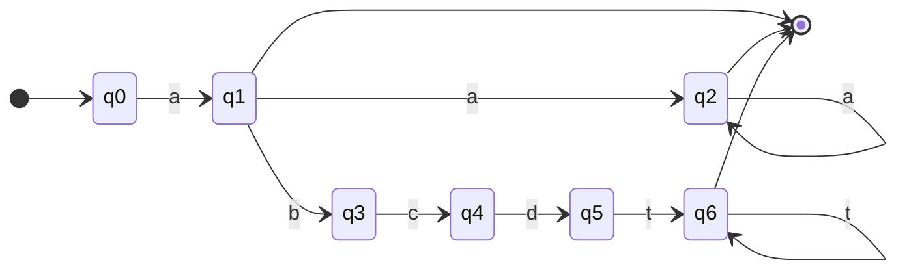
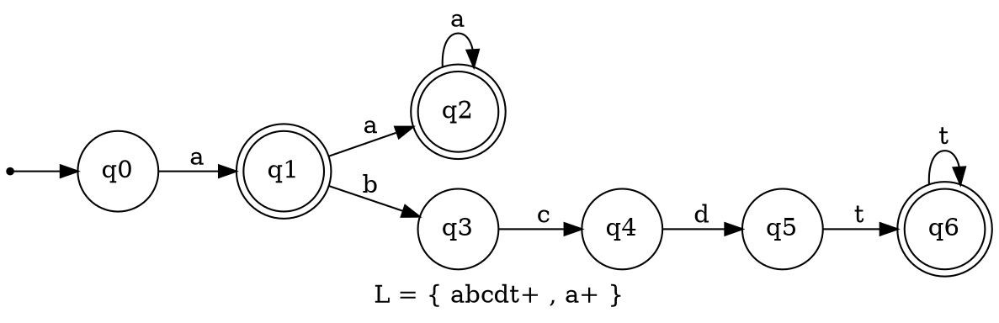

# Autómata de la bomba · Grupo 01

> Archivo generado por la aplicación a partir de config/integrantes.csv. No lo edite a mano.

| Integrante | Cédula | Último dígito | Coordenada |
|---|---|---|---|
| Integrante 1 | 1754265385 | 5 | Coord-05 |
| Integrante 2 | 1734567890 | 0 | Coord-00 |
| Integrante 3 | (cédula pendiente) | — | — |
| Integrante 4 | (cédula pendiente) | — | — |
| Integrante 5 | (cédula pendiente) | — | — |
| Integrante 6 | (cédula pendiente) | — | — |

Coordenadas objetivo: Coord-05, Coord-00

**L = { abcdt+ , a+ }**

## Definición formal

```
A = (Q, Σ, δ, q0, F)
Q  = {q0, q1, q2, q3, q4, q5, q6}
Σ  = {a, b, c, d, t}
q0 = q0
F  = {q1, q2, q6}
δ:
   δ(q0, a) = q1
   δ(q1, a) = q2
   δ(q1, b) = q3
   δ(q2, a) = q2
   δ(q3, c) = q4
   δ(q4, d) = q5
   δ(q5, t) = q6
   δ(q6, t) = q6
```

## Gramática

```
G = (N, T, P, S)
N = {S, A, B, C, D, E, F}
T = {a, b, c, d, t}
S = S
P:
   S → aA | a
   A → aB | a | bC
   B → aB | a
   C → cD
   D → dE
   E → tF | t
   F → tF | t
```

## Grafo



Graphviz (pegar en https://dreampuf.github.io/GraphvizOnline):


